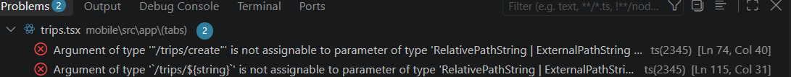
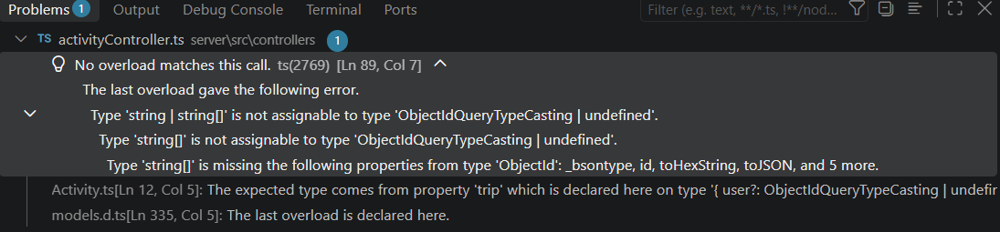
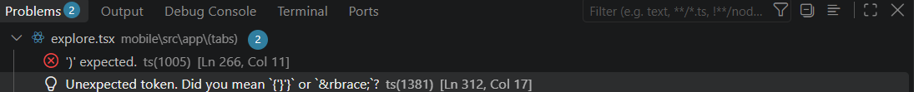

# TripN

TripN is a full-stack trip planning application that helps users organize their travel plans in one place.

Users can create trips, build itineraries, manage travel expenses, search and save places, and check current weather information for destinations.

The application was created as a capstone project for a software development bootcamp.

## Features

### Authentication

- Create a user account
- Log in securely
- Password hashing
- JWT authentication
- Persistent user sessions
- Protected application routes
- Log out

### Trip Management

Users can:

- Create trips
- View their trips
- Edit trip details
- Delete trips
- Add destinations
- Set start and end dates
- Add trip descriptions
- Set a planned budget

### Itinerary

Each trip can include itinerary activities with:

- Activity name
- Date
- Time
- Location
- Notes

Activities can be added, edited, viewed, and removed.

### Budget and Expenses

Users can:

- Set a planned trip budget
- Add expenses
- Categorize expenses
- Record expense dates
- View total spending
- View the remaining budget
- Remove expenses

### Place Search

TripN integrates with the Geoapify API to provide location search.

Users can:

- Search for cities and places
- View formatted location results
- View latitude and longitude
- Save locations
- View saved places
- Remove saved places

### Weather

TripN integrates with the OpenWeather API.

For a selected location, users can view:

- Current temperature
- Feels-like temperature
- Weather conditions
- Humidity
- Wind speed

## Tech Stack

### Frontend

- React Native
- Expo
- Expo Router
- TypeScript
- React Context
- Expo SecureStore
- React Native Web

### Backend

- Node.js
- Express
- TypeScript
- MongoDB Atlas
- Mongoose
- JSON Web Tokens
- bcryptjs

### APIs

- Geoapify
- OpenWeather

## Project Structure

```text
travel-planner/
├── mobile/
│   ├── assets/
│   ├── src/
│   │   ├── app/
│   │   ├── components/
│   │   ├── constants/
│   │   ├── context/
│   │   ├── services/
│   │   └── utils/
│   ├── app.json
│   └── package.json
│
├── server/
│   ├── src/
│   │   ├── config/
│   │   ├── controllers/
│   │   ├── middleware/
│   │   ├── models/
│   │   └── routes/
│   └── package.json
│
└── README.md
```

## Installation

### 1. Clone the repository

```bash
git clone https://github.com/vicksidhu/TripN.git
cd travel-planner
```

## Backend Setup

Navigate to the server:

```bash
cd server
```

Install dependencies:

```bash
npm install
```

Create a `.env` file inside the `server` folder.

Add the following environment variables:

```env
PORT=5000
MONGO_URI=your_mongodb_connection_string
JWT_SECRET=your_jwt_secret
```

Start the development server:

```bash
npm run dev
```

The local API runs on:

```text
http://localhost:5000
```

A health check is available at:

```text
http://localhost:5000/api/health
```

## Mobile / Frontend Setup

Open another terminal and navigate to the mobile project:

```bash
cd mobile
```

Install dependencies:

```bash
npm install
```

Create a `.env` file inside the `mobile` folder.

Add:

```env
EXPO_PUBLIC_GEOAPIFY_API_KEY=your_geoapify_api_key
EXPO_PUBLIC_OPENWEATHER_API_KEY=your_openweather_api_key
```

Start Expo:

```bash
npx expo start
```

The application can then be run using:

- Android emulator
- Expo-supported native development environment
- Web browser

## Web Development

To start TripN for web development:

```bash
npx expo start --web
```

The web application communicates with the local Express API during development.

## Production Build

### Backend

Build the TypeScript backend:

```bash
npm run build
```

Start the compiled server:

```bash
npm start
```

### Web

Create the production web export:

```bash
npx expo export --platform web
```

The generated web files are placed in the `mobile/dist` directory.

## Security

TripN includes several security measures:

- User passwords are hashed before being stored in MongoDB.
- JWTs are used to authenticate protected API requests.
- Protected backend routes verify the authenticated user.
- Trips, activities, expenses, and saved places are associated with the authenticated user.
- Environment files containing credentials and API keys are excluded from Git.
- Native authentication data is stored using Expo SecureStore.

## Testing

TripN was tested throughout development on both the Android emulator and web browser. Testing included frontend validation, backend API behavior, database persistence, authentication, CRUD operations, third-party API integrations, and cross-platform behavior.

| Test | Expected Result | Result |
|---|---|---|
| Register with valid information | Account is created and stored in MongoDB | Pass |
| Register with missing fields | Validation message is displayed | Pass |
| Register with invalid email | Invalid email is rejected | Pass |
| Register with short password | Password under 8 characters is rejected | Pass |
| Register with mismatched passwords | Registration is prevented | Pass |
| Register with duplicate email | Existing account is not duplicated | Pass |
| Login with correct credentials | User is authenticated successfully | Pass |
| Login with incorrect password | Login is rejected | Pass |
| Password storage | Password is stored as a hash rather than plain text | Pass |
| Session persistence | User remains authenticated after the application reloads | Pass |
| Logout | Session is removed and protected screens become inaccessible | Pass |
| Create trip | Trip is saved and displayed under My Trips | Pass |
| View trip | Saved trip information is loaded correctly | Pass |
| Edit trip | Updated trip information persists | Pass |
| Delete trip | Trip is removed | Pass |
| Add itinerary activity | Activity is saved and displayed in the itinerary | Pass |
| Edit itinerary activity | Updated activity information persists | Pass |
| Remove itinerary activity | Activity is removed from the itinerary | Pass |
| Itinerary date display | Calendar date displays consistently on Android and web | Pass |
| Add expense | Expense is saved and total spending updates | Pass |
| Remove expense | Expense is removed and budget totals recalculate | Pass |
| Remaining budget | Planned budget minus expenses is calculated correctly | Pass |
| Geoapify place search | Matching location results are returned | Pass |
| Save place | Selected location is saved to the user's account | Pass |
| Saved place persistence | Saved location remains after application reload | Pass |
| Remove saved place | Saved location is removed | Pass |
| OpenWeather lookup | Current weather is returned for the selected coordinates | Pass |
| User data protection | Protected API requests require authentication | Pass |
| Android testing | Core application workflow functions on Android emulator | Pass |
| Web testing | Core application workflow functions in web browser | Pass |

## Debugging

## Debugging

Several issues were identified and resolved while developing and deploying TripN. Testing throughout development helped identify problems across frontend navigation, TypeScript, API communication, cross-platform behavior, and deployment.

### Web CORS Error

**Problem:**  
Registration and login worked on the Android emulator, but requests from the web application were blocked by the browser with a CORS error:

```text
No 'Access-Control-Allow-Origin' header is present on the requested resource.
```

**Cause:**  
The Expo web application and Express API were running on different origins during development.

**Solution:**  
CORS middleware was added to the Express server and configured to allow requests from the TripN web frontend.

**Result:**  
Authentication and API requests worked successfully on both Android and web.

### Expo Router Authentication Group Warning

**Problem:**  
Expo Router displayed the following warning:

```text
No route named "(auth)" exists in nested children
```

The login and register screens existed, but Expo Router did not recognize `(auth)` as its own nested navigator.

**Solution:**  
An `_layout.tsx` file was added inside the `(auth)` route group.

**Result:**  
The warning disappeared and the authentication navigation structure worked correctly.

### Expo Router Typed Route Errors

**Problem:**  
TypeScript reported errors when navigating to the trip creation screen and the dynamic trip details route.

The original dynamic navigation used:

```tsx
router.push(`/trips/${item._id}`)
```



**Solution:**  
Dynamic navigation was changed to use Expo Router's typed pathname and parameter structure:

```tsx
router.push({
  pathname: '/trips/[id]',
  params: {
    id: item._id,
  },
});
```

**Result:**  
The TypeScript errors were removed and users could navigate to individual trip details correctly.

### Express Route Parameter Type Error

**Problem:**  
While building the itinerary backend, TypeScript reported:

```text
No overload matches this call.
```

The error showed that:

```text
string | string[]
```

was not assignable to the type expected by the Mongoose query.



**Cause:**  
The Express route parameters were being interpreted more broadly than the string values expected by the activity controller and Mongoose query.

**Solution:**  
Explicit route parameter types were added to the Express request handlers:

```ts
type TripParams = {
  tripId: string;
};

type ActivityParams = {
  tripId: string;
  activityId: string;
};
```

**Result:**  
The TypeScript error was removed, the server compiled successfully, and the itinerary endpoints worked correctly.

### Cross-Platform Itinerary Date Bug

**Problem:**  
An itinerary activity displayed the intended calendar date on Android but appeared one day earlier on web.

**Cause:**  
The stored calendar date was being converted to a JavaScript `Date` and then displayed using local timezone formatting.

**Solution:**  
TripN formats calendar-only itinerary dates directly from their `YYYY-MM-DD` value:

```tsx
const formatActivityDate = (date: string) => {
  const dateOnly = date.slice(0, 10);
  const [year, month, day] = dateOnly.split('-');

  return `${month}/${day}/${year}`;
};
```

**Result:**  
Itinerary dates displayed consistently on Android and web.

### Saved Places JSX Syntax Error

**Problem:**  
Adding the Saved Places feature to the Explore screen introduced two JSX/TypeScript syntax errors:

```text
')' expected.
```

and:

```text
Unexpected token.
```



**Cause:**  
The conditional rendering block for the selected place was being closed after the Saved Places section instead of immediately after the Selected Place card.

**Solution:**  
The selected-place conditional was closed before rendering the separate Saved Places section:

```tsx
{selectedPlace ? (
  <View style={styles.selectedCard}>
    ...
  </View>
) : null}

<View style={styles.savedSection}>
  ...
</View>
```

**Result:**  
The JSX errors were removed and users could search, save, view, and remove locations successfully.

### Explore Screen State and Scrolling

**Problem:**  
After viewing weather for one location and searching for another, weather from the previous location could remain visible. Saving a place also left the previous search information on screen, and the expanded Explore screen became difficult to scroll on Android.

**Solution:**  
Search, selected-place, weather, and error state were reset when appropriate. The Explore screen was also changed to use a scrollable layout, and the small search-results list was rendered directly rather than using a nested list.

**Result:**  
New searches no longer display stale weather information, saving a location resets the search state, and the full Explore screen scrolls correctly.

### MongoDB Atlas Connection Failure During Deployment

**Problem:**  
The first Render backend deployment failed when the deployed Express server attempted to connect to MongoDB Atlas.

The Render log reported:

```text
MongooseServerSelectionError:
Could not connect to any servers in your MongoDB Atlas cluster.
```

**Cause:**  
MongoDB Atlas Network Access was not configured to permit connections from the deployed Render service.

**Solution:**  
MongoDB Atlas Network Access was updated so the Render backend could connect to the database.

**Result:**  
The next Render deployment succeeded. The deployed API health endpoint returned:

```text
TripN API is running
```

## Deployment

- Web application: https://tripn-web.onrender.com
- API: https://tripn-aurn.onrender.com

## Future Improvements

Possible future improvements include:

- Trip sharing and collaboration
- Interactive maps
- Expense editing
- Expense categories and visual charts
- Currency conversion
- Expanded weather forecasts
- Improved date and time pickers
- Travel photo uploads
- Additional profile settings
